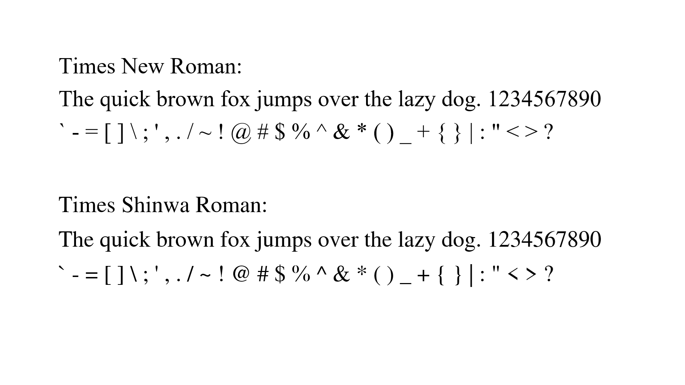
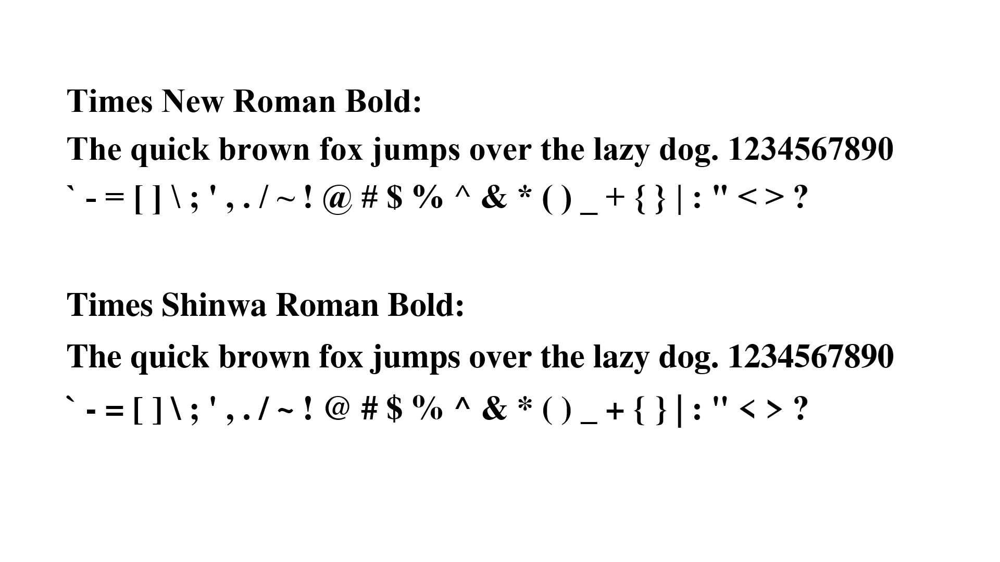
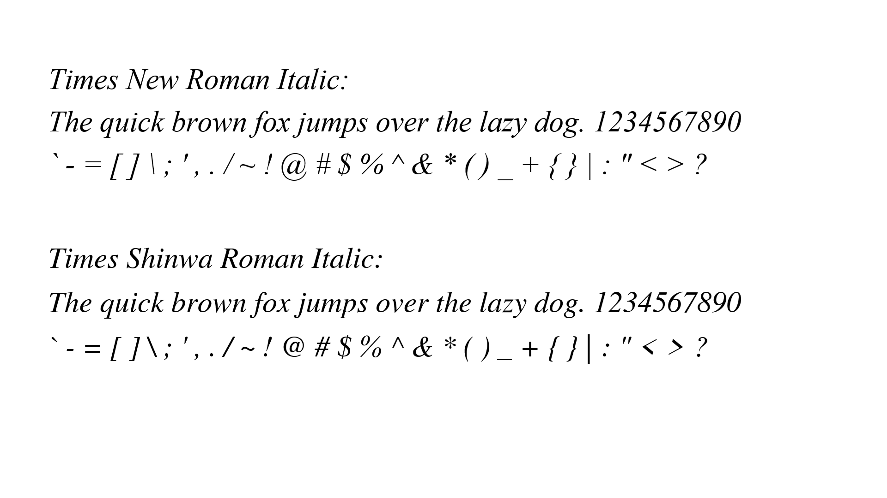
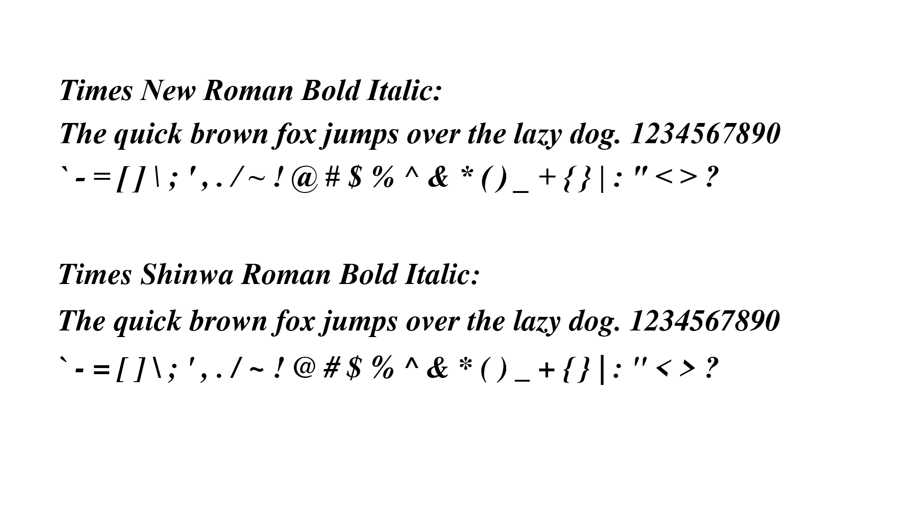

# Times Shinwa Roman

**A Nimbus Roman alternative inspired by Times New Roman.**

[English](#english) | [简体中文](#简体中文) | [日本語](#日本語)

---

## English

### About

**Times Shinwa Roman** is a modified version of Nimbus Roman, redesigned to resemble Times New Roman more closely.

The original Nimbus Roman appears visually closer to Linotype's Times than to Monotype's Times New Roman. This project aims to bridge that visual gap by modifying Nimbus Roman to make it a more suitable alternative to Times New Roman.

### Font Preview

Regular: 

Bold: 

Italic: 

Bold Italic: 

### Licence and Usage

Times Shinwa Roman is distributed under the **SIL Open Font License (OFL)**. It may be used for personal, professional, and commercial projects, subject to the terms of the licence.

You are welcome to use the font in documents, publications, graphic designs, software, and commercial products.

**Please do not sell the font itself as a standalone product.** Keep it accessible and free for everyone to use, in accordance with the applicable licence terms.

**Free to use. Free for commercial use. Just don't sell the font itself!**

---

## 简体中文

### 项目简介

**Times Shinwa Roman（时报神话罗马体）** 是一款基于 Nimbus Roman 修改而成的字体，旨在使其字形外观更加接近 Times New Roman。

原版 Nimbus Roman 的视觉风格似乎更接近 Linotype 公司的 Times，而非 Monotype 公司的 Times New Roman。本项目通过修改 Nimbus Roman，尝试缩小两者之间的视觉差异，使其成为更适合替代 Times New Roman 的字体。

### 字体预览

常规: 

粗体: 

斜体: 

粗斜体: 

### 许可证与使用方式

Times Shinwa Roman 采用 **SIL Open Font License（SIL 开放字体许可证，简称 OFL）** 发布。在遵守许可证条款的前提下，用户可以将其用于个人、专业及商业项目。

你可以将本字体用于文档、出版物、平面设计、软件及商业产品。

**请勿将字体本身作为独立商品出售。** 希望这款字体能够继续免费供所有人使用，并在遵守适用许可证条款的前提下保持开放。

**免费使用，免费商用，但请不要单独出售字体本身！**

---

## 日本語

### プロジェクトについて

**Times Shinwa Roman（タイムズ神話ローマン）** は、Times New Roman により近い字形を目指して Nimbus Roman を改変したフォントです。

オリジナルの Nimbus Roman は、Monotype の Times New Roman よりも、Linotype の Times に近い印象を与えます。本プロジェクトでは、Nimbus Roman の字形を調整することで、両者の視覚的な違いを縮め、Times New Roman の代替フォントとしてより使いやすくすることを目指しています。

### フォントプレビュー

標準 / レギュラー: 

太字 / ボールド: 

斜体 / イタリック: 

太斜体 / ボールドイタリック: 

### ライセンスと使用条件

Times Shinwa Roman は **SIL Open Font License（OFL）** の下で配布されています。ライセンスの条件に従う限り、個人利用、業務利用、商用利用が可能です。

文書、出版物、グラフィックデザイン、ソフトウェア、商用製品など、さまざまな用途にご利用いただけます。

**フォントそのものを単独の商品として販売しないでください。** 適用されるライセンス条件を守りながら、誰もが無料で利用できるフォントであり続けることを願っています。

**無料で利用可能。商用利用も可能。ただし、フォントそのものの単独販売はご遠慮ください！**

---

## Licence

This project is distributed under the SIL Open Font License. See [`OFL.txt`](OFL.txt) for the full licence text.

本项目采用 SIL Open Font License 发布。完整许可证文本请参阅 [`OFL.txt`](OFL.txt)。

本プロジェクトは SIL Open Font License の下で配布されています。ライセンス全文については [`OFL.txt`](OFL.txt) をご覧ください。
